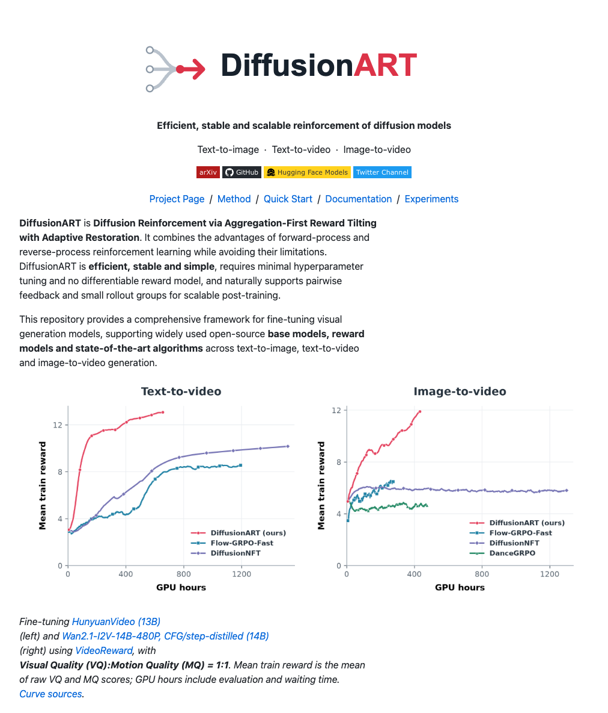
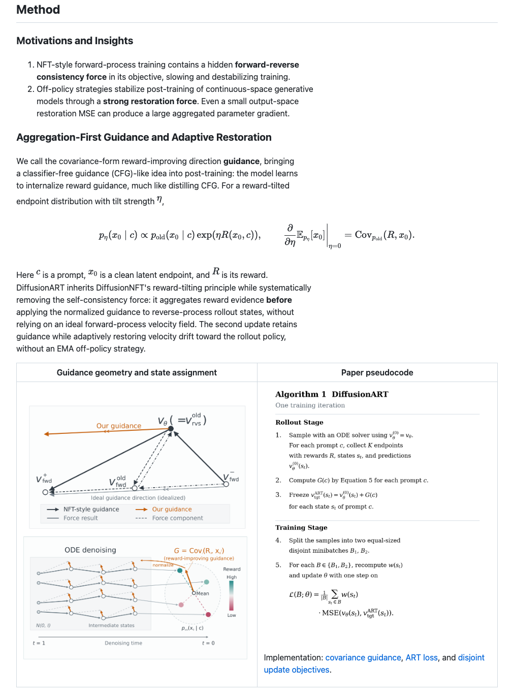
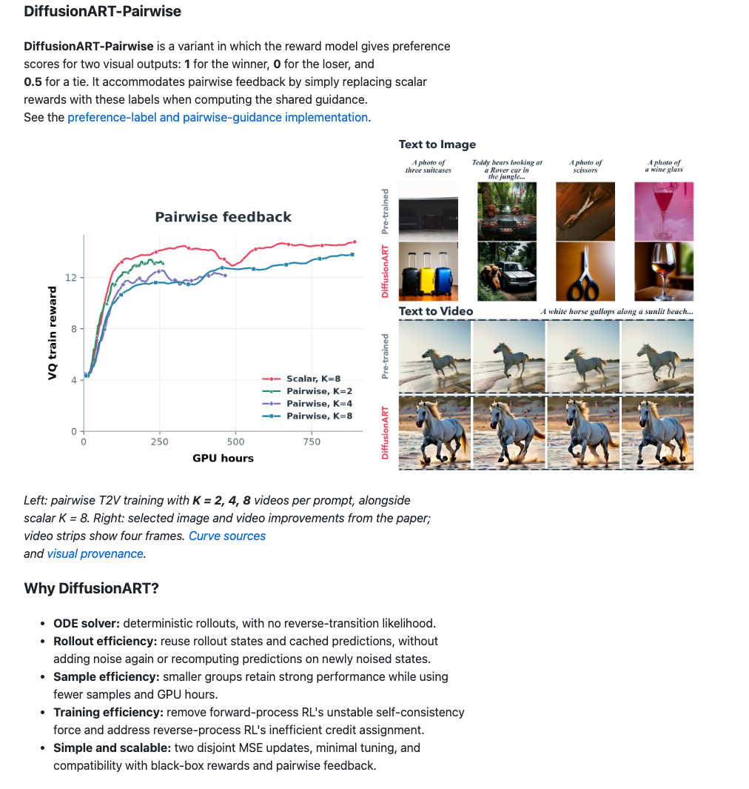

# Rendered README Review

Snapshot of README revision `20595c4`, captured in Edge using GitHub-sanitized
Markdown, GitHub-like styling and KaTeX for formulas. These are visual review
artifacts, not additional experiment results.

[Open the GitHub-rendered README](../../README.md) ·
[Full desktop preview](readme-1280.png) · [Full mobile preview](readme-390.png)

## Introduction and Efficiency

## Method

## Pairwise and Advantages

The full previews include News, Quick Start, supported models, configuration,
results and experiment links. Desktop width: 1280 px; mobile width: 390 px.
