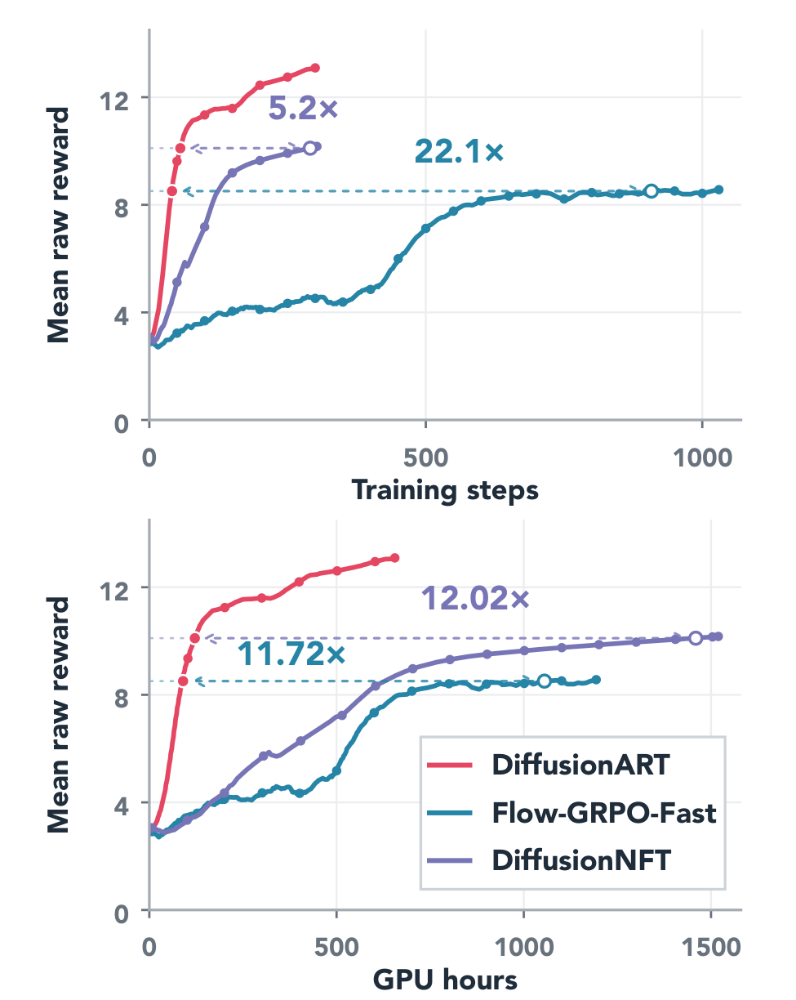
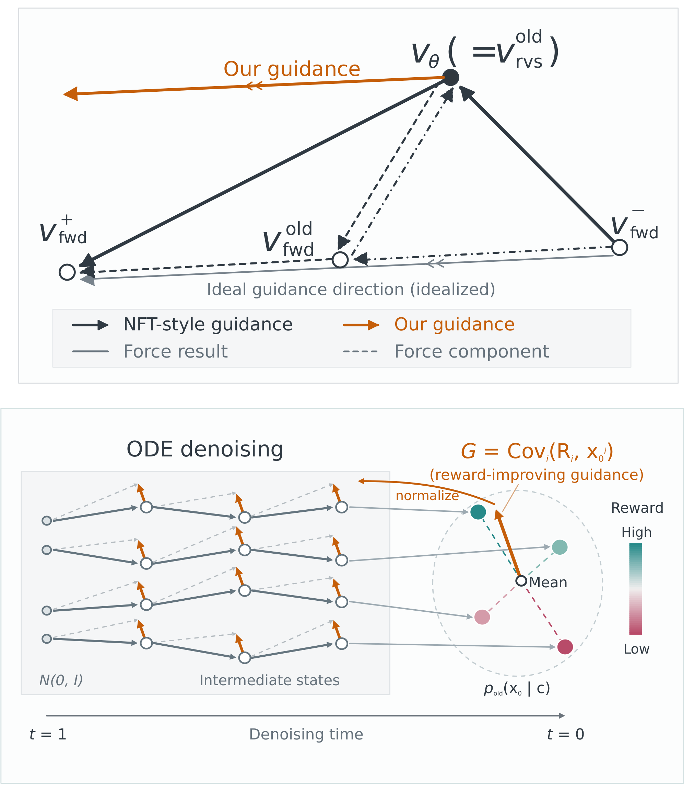
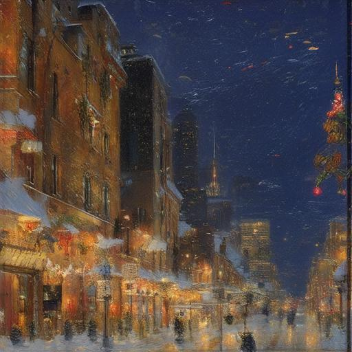
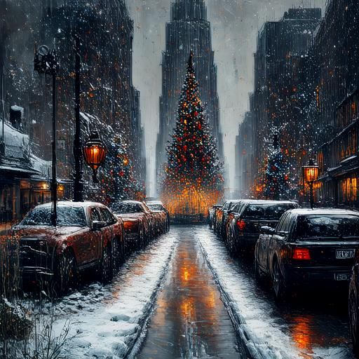
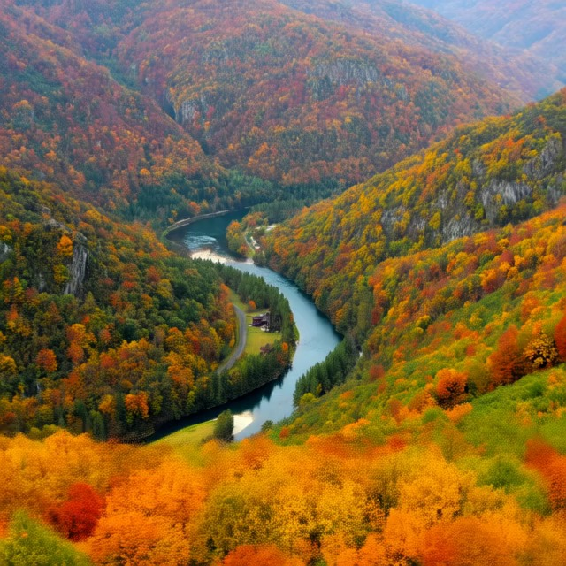

<p align="center">
  
</p>

<p align="center"><strong>Efficient, stable and scalable reinforcement of diffusion models</strong></p>
<p align="center">Text-to-image &nbsp;&middot;&nbsp; Text-to-video &nbsp;&middot;&nbsp; Image-to-video</p>

<!-- Resource badges are intentionally unlinked until their destinations are supplied. -->
<p align="center">
  
  
  
  
</p>

<p align="center">
  <a href="https://vanzll.github.io/diffusionart-project/">Project Page</a> &nbsp;/&nbsp;
  <a href="#quick-start">Quick Start</a> &nbsp;/&nbsp;
  <a href="docs/README.md">Documentation</a> &nbsp;/&nbsp;
  <a href="#paper-experiments">Experiments</a>
</p>

**DiffusionART** is **Diffusion Reinforcement via Aggregation-First Reward Tilting
with Adaptive Restoration**. It combines the strengths of forward- and
reverse-process reinforcement learning while avoiding their limitations.
DiffusionART is highly efficient, stable, and simple to use, without additional
hyperparameter tuning. It requires no differentiable reward model, naturally
supports pairwise reward models, and remains robust with small rollout groups,
providing a highly scalable approach to fine-tuning diffusion models.

<table>
  <tr>
    <td width="45%" align="center" valign="middle">
      
    </td>
    <td width="55%" align="center" valign="middle">
      
    </td>
  </tr>
</table>

## News

- 🎉 **[2026.10.01]** DiffusionART and six baselines are available in one framework for **T2I, T2V and I2V**. Explore the [training recipes](#paper-experiments)!

## Quick Feature Summary

| Feature Category | Supported Capabilities |
| --- | --- |
| **Tasks** | ✅ Text-to-image<br>✅ Text-to-video<br>✅ Image-to-video |
| **Algorithms** | ✅ DiffusionART<br>✅ DiffusionNFT (EMA / on-policy)<br>✅ Flow-GRPO / Flow-GRPO-Fast<br>✅ Flow-DPPO / DanceGRPO<br>✅ ReFL (video) |
| **Base Models** | ✅ SD3.5-M<br>✅ FLUX.1-dev<br>✅ HunyuanVideo-13B<br>✅ Wan2.1-I2V-14B (CFG/step-distilled) |
| **Benchmarks** | ✅ GenEval<br>✅ OCR<br>✅ Pick-a-Pic (PickScore) |
| **Reward Models** | ✅ GenEval / PickScore / OCR<br>✅ CLIPScore / Aesthetic<br>✅ VideoReward (TA / VQ / MQ)<br>✅ Configurable reward weights |
| **Feedback** | ✅ Scalar rewards<br>✅ Pairwise preferences (Hunyuan ART)<br>✅ Small rollout groups: K = 2, 4, 8 |
| **Training** | ✅ LoRA / full-parameter tuning<br>✅ DDP / FSDP<br>✅ Checkpoint resume / local evaluation artifacts |

## Results

**HunyuanVideo-13B &middot; text-to-video.** Final evaluation from the paper:

| Method | VQ &uarr; | MQ &uarr; |
| --- | ---: | ---: |
| Pre-trained | 5.195 | 1.943 |
| Flow-GRPO-Fast | 6.279 | 3.222 |
| DanceGRPO | 6.173 | 3.121 |
| DiffusionNFT (EMA) | 6.827 | 2.683 |
| DiffusionNFT (on-policy) | 5.543 | 1.839 |
| **DiffusionART** | **8.970** | **4.224** |

ART and NFT use TA:VQ:MQ = 7:2:1; GRPO baselines use VQ:MQ = 1:1.
See [experiment recipes](#paper-experiments) and the
[project page](https://vanzll.github.io/diffusionart-project/) for learning curves
and playable comparisons. [Table source](assets/readme/results.json).

<table>
  <thead><tr><th width="50%">Pre-trained</th><th width="50%">DiffusionART</th></tr></thead>
  <tbody>
    <tr><th colspan="2">Text-to-image &middot; A snowy Chicago street at Christmas</th></tr>
    <tr>
      <td></td>
      <td></td>
    </tr>
    <tr><th colspan="2">Text-to-video &middot; A river through an autumn valley</th></tr>
    <tr>
      <td></td>
      <td></td>
    </tr>
  </tbody>
</table>

Selected paper examples; video cells show individual frames.
[Sample provenance](assets/readme/provenance.json).

## Supported Models

| Task | Model | Algorithms | Setup |
| --- | --- | --- | --- |
| T2I | **SD3.5-M** | ART, NFT, GRPO, Fast, DPPO, Dance | [SD3 guide](docs/sd3-runner.md) |
| T2I | **FLUX.1-dev** | ART, NFT, GRPO, Fast, DPPO | [FLUX guide](docs/flux-runner.md) |
| T2V | **HunyuanVideo-13B** | ART, NFT, Fast, Dance, ReFL | [Hunyuan guide](docs/hunyuan-runner.md) |
| I2V | **Wan2.1-I2V-14B, CFG/step-distilled** | ART, NFT, Fast, Dance, ReFL | [Wan guide](docs/wan-runner.md) |

Fast = Flow-GRPO-Fast; DPPO = Flow-DPPO; Dance = DanceGRPO.

| Reward | Tasks | Feedback |
| --- | --- | --- |
| **PickScore, GenEval, OCR, Aesthetic, CLIPScore** | T2I | Scalar scores and weighted combinations |
| **VideoReward: TA, VQ, MQ** | T2V / I2V | Scalar scores and weighted combinations |
| **Pairwise preferences** | Hunyuan T2V / ART | Binary preference labels derived from scorer comparisons |
| **Differentiable VideoReward** | Video ReFL | Pixel-space gradients; common MP4 scores for reporting |

See [algorithm contracts](docs/algorithm-provenance.md) and
[reward composition](docs/composite-rewards.md) for method-specific behavior.

## Quick Start

### 1. Install

Use Python 3.10+ and [uv](https://docs.astral.sh/uv/getting-started/installation/).
Pretrained training requires Linux and CUDA.

```bash
git clone https://github.com/vanzll/DiffusionART.git
cd DiffusionART
uv sync --locked --python 3.10
```

<details>
<summary><strong>Optional: four-update CPU installation check</strong></summary>

No GPU, model downloads or W&B account needed:

```bash
uv run --locked visual-rl --config configs/examples/cpu_smoke.yaml --validate
uv run --locked visual-rl --config configs/examples/cpu_smoke.yaml
```

`outputs/cpu-smoke/status.json` should report `completed` and four optimizer
steps. To repeat, pass `--output-dir outputs/cpu-smoke-2`.

</details>

### 2. Prepare Assets

Follow the matching [model guide](#supported-models) for model access, pinned
weights, reward models and prompt data. Images use the `diffusers` extra;
videos use the [pinned video environment](docs/video-installation.md).

### 3. Train

After preparing SD3 and PickScore assets:

```bash
uv run --locked --extra diffusers visual-rl \
  --config configs/examples/sd3_pickscore.yaml
```

For an eight-GPU paper image recipe, prepare its [data and assets](docs/paper-image.md), then:

```bash
uv run --locked --extra diffusers torchrun --standalone --nproc-per-node=8 \
  -m visual_rl.train --config configs/paper/image/sd3_pickscore_art.yaml
```

Video recipes use the same entrypoint inside the prepared video environment:

```bash
torchrun --standalone --nproc-per-node=8 -m visual_rl.train \
  --config configs/paper/video/hunyuan_art_721.yaml
```

Add `--validate` for config checks before loading models. See
[distributed execution](docs/distributed-execution.md) for multi-node launches and
[checkpoint/resume](docs/checkpoint-resume.md) for recovery and evaluation.

## Configure Your Experiment

Extend an [example](configs/examples/) or [paper recipe](configs/paper/).
Save this as `configs/my-pickscore.yaml`:

```yaml
extends: examples/sd3_pickscore.yaml
name: my-pickscore
training:
  max_updates: 1000
runtime:
  output_dir: outputs/my-pickscore
  checkpoint_keep: 2
```

```bash
uv run --locked --extra diffusers visual-rl --config configs/my-pickscore.yaml
```

Select components through `model.name`, `algorithm.name` and `reward.name`;
compose objectives with `reward.weights`. Sampling, microbatches, evaluation
and checkpoint cadence live in the same file. Required asset paths use `${ENV_VAR}`.

Metrics are saved to `metrics.jsonl`; evaluation images, videos and scores stay
on disk. Set `runtime.log: wandb` for [scalar logging](docs/logging.md).

## Paper Experiments

| Task | Benchmark / reward | Configs | Selected ART runs |
| --- | --- | --- | --- |
| T2I | GenEval, PickScore, OCR, joint rewards | [Image recipes](docs/paper-image.md) | [GenEval](https://wandb.ai/vanzl3386-chinese-university-of-hong-kong-shenzhen/flow-grpo-algo/runs/11pq0iy3) &middot; [PickScore](https://wandb.ai/vanzl3386-chinese-university-of-hong-kong-shenzhen/flow-grpo-algo/runs/mofumvbw) &middot; [OCR](https://wandb.ai/vanzl3386-chinese-university-of-hong-kong-shenzhen/flow-grpo-algo/runs/9c0zrzlw) |
| T2V | TA:VQ:MQ = 7:2:1; scalar / pairwise VQ | [Video recipes](docs/paper-video.md) | [Main](https://wandb.ai/vanzl3386-chinese-university-of-hong-kong-shenzhen/flow-grpo-algo/runs/gyvtocue) &middot; [Pairwise K=2](https://wandb.ai/vanzl3386-chinese-university-of-hong-kong-shenzhen/flow-grpo-algo/runs/x9mzbm4c) |
| I2V | VQ:MQ = 1:1 | [Video recipes](docs/paper-video.md) | [Main](https://wandb.ai/vanzl3386-chinese-university-of-hong-kong-shenzhen/flow-grpo-algo/runs/08ca4146a532752c473f1f37) |

Baseline runs and source commits are in the [run inventory](docs/reproduction-inventory.json).
W&B links may require access. Current validation covers CPU integration and
distributed tests; pretrained GPU acceptance and paper-number parity remain
pending. [Release scope](docs/release-scope.md).

## Learn More

[Documentation](docs/README.md) &nbsp;/&nbsp;
[Development](docs/development.md) &nbsp;/&nbsp;
[Model interfaces](docs/model-contract.md) &nbsp;/&nbsp;
[Reward interfaces](docs/reward-contract.md)

## Acknowledgements

Built on [Flow-GRPO](https://github.com/yifan123/flow_grpo),
[DiffusionNFT](https://github.com/NVlabs/DiffusionNFT),
[DanceGRPO](https://github.com/XueZeyue/DanceGRPO) and
[UniRL](https://github.com/Tencent-Hunyuan/UniRL).
README organization draws inspiration from
[verl-agent](https://github.com/langfengQ/verl-agent) and Flow-GRPO.
See [third-party notices](THIRD_PARTY_NOTICES.md) for attribution and asset terms;
the project-wide license is pending.
