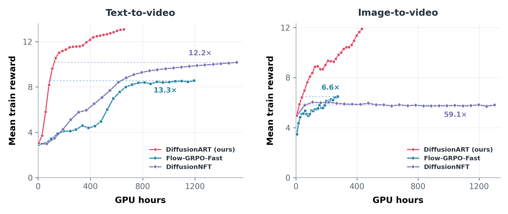
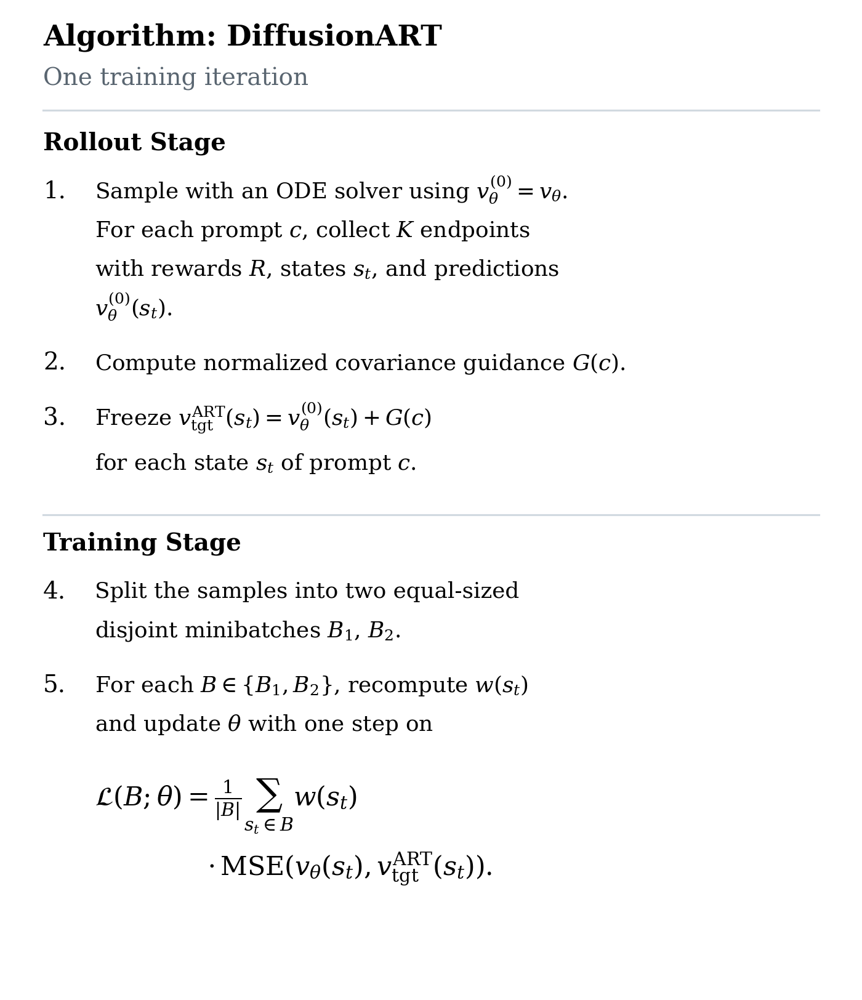
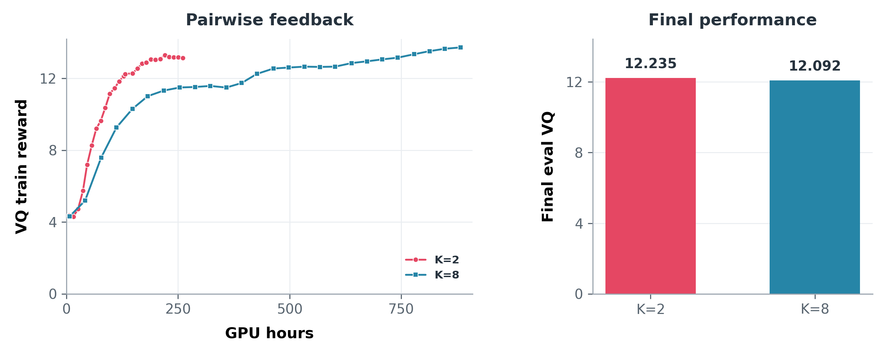
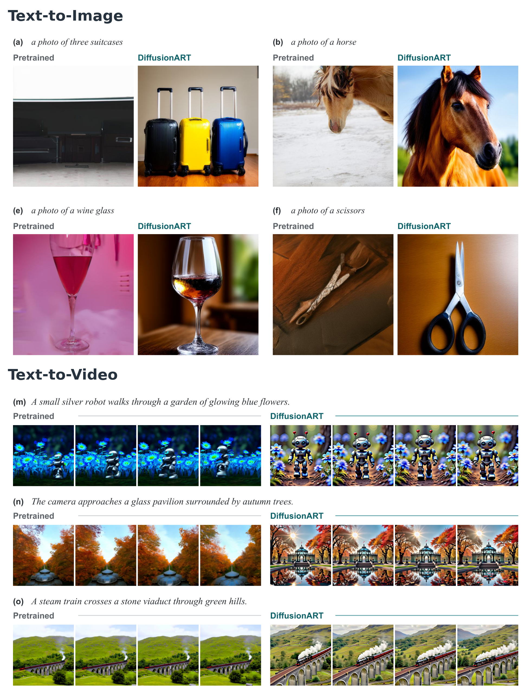

<p align="center">
  
</p>

<p align="center"><strong>Efficient, stable and scalable reinforcement of diffusion models</strong></p>
<p align="center">Text-to-image &nbsp;&middot;&nbsp; Text-to-video &nbsp;&middot;&nbsp; Image-to-video</p>

<p align="center">
  <a href="https://arxiv.org/abs/2610.12572"></a>
  <a href="https://github.com/vanzll/DiffusionART"></a>
  <a href="https://x.com/Vanzllll/status/2109578565893210580"></a>
  <a href="https://huggingface.co/papers/2610.12572"></a>
  <a href="https://huggingface.co/collections/vanzl/diffusionart-6acc498d285b7e7c4dbd16b7"></a>
  <a href="https://vanzll.github.io/diffusionart-project/"></a>
  <a href="https://vanzll.github.io/diffusionart-project/demo.html"></a>
</p>

<p align="center">
  <a href="#method">Method</a> &nbsp;/&nbsp;
  <a href="#quick-start">Quick Start</a> &nbsp;/&nbsp;
  <a href="docs/faq.md">FAQ</a> &nbsp;/&nbsp;
  <a href="docs/README.md">Documentation</a>
</p>

## News

- 🎉 **[2026.10.12]** Our [paper](https://arxiv.org/abs/2610.12572), code, [models](#released-models) and [project page](https://vanzll.github.io/diffusionart-project/) are now public! DiffusionART and six baselines share one framework for **T2I, T2V and I2V**. Explore the [training recipes](configs/paper/)!

<details>
<summary><strong>Changelog</strong></summary>

- **2026.10.17:** ART now splits each prompt's trajectories evenly between its
  two update windows, retaining all prompts in each update even when a rank
  handles multiple prompts. Guidance still uses the full K-sample group.
  Image training uses a stratified random split; video training preserves
  trajectory order. Baseline update schedules are unchanged.

- **2026.10.14:** Fixed Hunyuan paper recipes that defaulted to rollout/update
  microbatches of 1 instead of 8 (ReFL remains 1/1). Microbatch size can strongly
  affect GPU utilization and training throughput. Use
  [commit `0fb23a7`](https://github.com/vanzll/DiffusionART/commit/0fb23a703358958b68c5f6c41798e04933f6001b)
  or a later version containing this fix. Smaller microbatches remain supported
  for memory-constrained devices; see [batch-size guidance](#implementation-notes-and-discussion).

</details>

---

**DiffusionART** is an on-policy diffusion RL algorithm via **Aggregation-First Reward
Tilting with Adaptive Restoration**. It combines the advantages of forward-process and
reverse-process reinforcement learning while avoiding their limitations.
DiffusionART is **highly efficient, stable and simple**, requires minimal hyperparameter
tuning and no differentiable reward model, naturally supports pairwise
feedback, and is robust to small rollout groups for scalable diffusion reinforcement learning.

This repository provides a comprehensive framework for fine-tuning visual
generation models, supporting widely used open-source **base models, reward
models and state-of-the-art algorithms** across text-to-image, text-to-video
and image-to-video generation.

<p align="center">
  
</p>

<p align="center"><em>
Fine-tuning <a href="https://huggingface.co/tencent/HunyuanVideo">HunyuanVideo (13B)</a> (left) and
<a href="https://huggingface.co/lightx2v/Wan2.1-I2V-14B-480P-StepDistill-CfgDistill-Lightx2v">Wan2.1-I2V-14B-480P, CFG/step-distilled (14B)</a> (right)
using <a href="https://huggingface.co/KlingTeam/VideoReward">VideoReward</a>, with <strong>Visual Quality (VQ):Motion Quality (MQ) = 1:1</strong>.
Mean train reward is the mean of raw VQ and MQ. T2V ratios compare GPU hours to reach each baseline's final reward level.
</em></p>

## Method

### Motivations and Insights

1. NFT-style forward-process RL contains a hidden **forward-reverse
   consistency force** in its objective, slowing and destabilizing training.
2. Off-policy strategies stabilize reinforcement learning of continuous-space generative
   models through a **strong restoration force**. Even a small output-space
   restoration MSE can produce a large aggregated parameter gradient.

### Aggregation-First Guidance and Adaptive Restoration

DiffusionART is simple: roll out **K samples per prompt** with an ODE solver,
compute the reward-endpoint covariance as **guidance**, apply it to the visited
states and actions, then perform **two disjoint minibatch updates**.
We call this reward-improving direction **guidance**, bringing
a classifier-free guidance (CFG)-like idea into diffusion RL: the model learns
to internalize reward guidance, much like distilling CFG. For a reward-tilted
endpoint distribution with tilt strength eta,

<p align="center"></p>

Here c is a prompt, x₀ is a clean latent endpoint, and R is its reward.
DiffusionART systematically removes the self-consistency force: it aggregates reward evidence **before**
applying the normalized guidance to reverse-process rollout states, without
relying on an ideal forward-process velocity field. The second update retains
guidance while adaptively restoring velocity drift toward the rollout policy,
without an EMA off-policy strategy.

<table>
  <tr>
    <th width="50%">Guidance geometry and state assignment</th>
    <th width="50%">Pseudocode</th>
  </tr>
  <tr>
    <td align="center" valign="middle">
      
    </td>
    <td valign="middle">
      
      <p>Implementation: <a href="src/visual_rl/algorithms/covariance.py">covariance guidance</a>, <a href="src/visual_rl/algorithms/art.py">ART loss</a>, and <a href="src/visual_rl/training/objectives.py">disjoint update objectives</a>.</p>
    </td>
  </tr>
</table>

### DiffusionART-Pairwise

**DiffusionART-Pairwise** is a variant in which the reward model gives preference
scores for two visual outputs: **1** for the winner, **0** for the loser, and
**0.5** for a tie. It accommodates pairwise feedback by simply replacing scalar
rewards with these labels when computing the shared guidance.
See the [preference-label and pairwise-guidance implementation](src/visual_rl/algorithms/covariance.py).

<p align="center">
  
</p>

<p align="center"><em>Pairwise T2V with <strong>K = 2 or 8</strong> videos per prompt.
Left: VQ train reward versus GPU hours. Right: final evaluation VQ and total GPU hours
for pairwise K = 2, 4, 8 and scalar K = 8, each trained for 400 updates.
</em></p>

### Key Advantages

- ✅ **ODE solver:** deterministic rollouts, with no reverse-transition likelihood.
- ✅ **Rollout efficiency:** reuse rollout states and cached predictions, without
  adding noise again or recomputing predictions on newly noised states.
- ✅ **Sample efficiency:** fewer samples per prompt with minimal performance loss
  and lower GPU-hour cost.
- ✅ **Training efficiency:** remove forward-process RL's unstable self-consistency
  force and address reverse-process RL's inefficient credit assignment.
- ✅ **Simple and scalable:** minimal hyperparameter tuning, no differentiable
  rewards required, and natural support for pairwise reward models.

## Visualization Results

<p align="center"></p>

<p align="center"><em>Pre-trained versus DiffusionART. Video strips show four frames.</em></p>

## Released Models

| Task | Model | Release |
| --- | --- | --- |
| Text-to-image | SD3.5-M · Multi-Reward | [Hugging Face](https://huggingface.co/vanzl/DiffusionART-SD35M-MultiReward) |
| Text-to-video | HunyuanVideo-13B | [Hugging Face](https://huggingface.co/vanzl/DiffusionART-HunyuanVideo) |

Each model card includes its inference setup, base-model requirements and examples.

## Quick Feature Summary

| Feature Category | Supported Capabilities |
| --- | --- |
| **Tasks** | ✅ Text-to-image<br>✅ Text-to-video<br>✅ Image-to-video |
| **Algorithms** | ✅ DiffusionART<br>✅ DiffusionNFT (EMA / on-policy)<br>✅ Flow-GRPO / Flow-GRPO-Fast<br>✅ Flow-DPPO<br>✅ DanceGRPO<br>✅ ReFL (video) |
| **Base Models** | ✅ [SD3.5-M](docs/sd3-runner.md)<br>✅ [FLUX.1-dev](docs/flux-runner.md)<br>✅ [HunyuanVideo-13B](docs/hunyuan-runner.md)<br>✅ [Wan2.1-I2V-14B (CFG/step-distilled)](docs/wan-runner.md) |
| **Reward Models** | ✅ GenEval / PickScore / OCR<br>✅ CLIPScore / Aesthetic<br>✅ [VideoReward (TA / VQ / MQ)](docs/video-installation.md)<br>✅ [Configurable reward weights](docs/composite-rewards.md) |
| **Feedback** | ✅ Scalar rewards<br>✅ Pairwise preferences (Hunyuan ART)<br>✅ Configurable rollout groups: K = 2, 4, 8 |
| **Training** | ✅ LoRA / full-parameter tuning<br>✅ DDP / FSDP<br>✅ Checkpoint resume / local evaluation artifacts |

## Quick Start

### 1. Install

Use Python 3.10+ and [uv](https://docs.astral.sh/uv/getting-started/installation/).
Pretrained training requires Linux and CUDA.

```bash
git clone https://github.com/vanzll/DiffusionART.git
cd DiffusionART
uv sync --locked --python 3.10 --extra diffusers
```

<details>
<summary><strong>Optional: four-update CPU installation check</strong></summary>

No GPU, model downloads or W&B account needed:

```bash
uv run --locked visual-rl --config configs/examples/cpu_smoke.yaml --validate
uv run --locked visual-rl --config configs/examples/cpu_smoke.yaml
```

`outputs/cpu-smoke/status.json` should report `completed` and four optimizer
steps. To repeat, pass `--output-dir outputs/cpu-smoke-2`.

</details>

### 2. Configure Access

Accept the model license on Hugging Face, then configure `HF_TOKEN` and
`WANDB_API_KEY`, or use existing Hub/W&B logins. Paper recipes enable W&B by
default. Set `VISUAL_RL_ASSET_ROOT` to choose a writable asset cache.
Videos use the [pinned video environment](docs/video-installation.md).

### 3. Train

Run the complete SD3 PickScore experiment on eight GPUs:

```bash
uv run --locked --extra diffusers visual-rl \
  --config configs/paper/image/sd3_pickscore_art.yaml --nproc-per-node 8
```

The command prepares pinned models and prompt data before starting **1000
training updates**. Missing models are downloaded from Hugging Face automatically;
existing assets are reused. No manual model download is required for this recipe.
GenEval and OCR also download benchmark prompts from
[our HF dataset](https://huggingface.co/datasets/vanzl/DiffusionART-Prompts).
First complete the [GenEval scorer setup](docs/geneval.md) or
[OCR scorer setup](docs/sd3-ocr.md), then use the full training command in that
guide. See [all image recipes](docs/paper-image.md) for other algorithms.

Resume the latest complete checkpoint, optionally extending the total budget:

```bash
uv run --locked --extra diffusers visual-rl \
  --config configs/paper/image/sd3_pickscore_art.yaml --nproc-per-node 8 \
  --resume latest --max-updates 1500
```

Video recipes use the same entrypoint inside the video environment.
For shared multi-node preparation, generate a fresh launch ID once:

```bash
python -c 'import uuid; print(uuid.uuid4().hex)'
```

Export that **same value** as `PREPARATION_RUN_ID` on every node. This lets
peers reuse one full asset validation within this launch; use a new ID on restart.
T2V (400 updates):

```bash
visual-rl --config configs/paper/video/hunyuan_art_721.yaml \
  --nproc-per-node 8 --nnodes 4 --node-rank "$NODE_RANK" \
  --master-addr "$MASTER_ADDR" --preparation-run-id "$PREPARATION_RUN_ID" \
  --rendezvous-timeout-seconds 7200
```

I2V (400 updates, automatically generated evaluation references):

```bash
visual-rl --config configs/examples/wan_art_online_eval.yaml \
  --nproc-per-node 8 --nnodes 4 --node-rank "$NODE_RANK" \
  --master-addr "$MASTER_ADDR" --preparation-run-id "$PREPARATION_RUN_ID" \
  --rendezvous-timeout-seconds 7200
```

Run on each node with its rank and a shared asset/output root. Models and
prompt data are prepared from HF automatically. I2V generates FLUX evaluation
images on first use and caches them for later evaluations and resume; no
pre-existing image manifest is needed. This is a new evaluation protocol,
separate from historical fixed-image results. See the
[I2V guide](docs/wan-runner.md#automatic-evaluation-references) for baseline
recipes and shared reference caches.
Add `--prepare-only` to prepare without training, or `--validate` for network-free checks. See
[distributed execution](docs/distributed-execution.md) for multi-node launches and
[checkpoint/resume](docs/checkpoint-resume.md) for recovery and evaluation.

## Configure Your Experiment

Extend an [example](configs/examples/) or [paper recipe](configs/paper/).
Save this as `configs/my-pickscore.yaml`:

```yaml
extends: examples/sd3_pickscore.yaml
name: my-pickscore
training:
  max_updates: 1000
runtime:
  output_dir: outputs/my-pickscore
  checkpoint_keep: 2
```

```bash
uv run --locked --extra diffusers visual-rl --config configs/my-pickscore.yaml
```

Select components through `model.name`, `algorithm.name` and `reward.name`;
compose objectives with `reward.weights`. Sampling, microbatches, evaluation
and checkpoint cadence live in the same file. Required asset paths use `${ENV_VAR}`.

Metrics are saved to `metrics.jsonl`; evaluation images, videos and scores stay
on disk. Set `runtime.log: wandb` for [scalar logging](docs/logging.md).

## Implementation Notes and Discussion

**Covariance normalization.** Normalize the aggregated covariance before
constructing the regression target. This controls the guidance scale independently
of the raw covariance magnitude. For multiple rewards, combine their weighted
contributions before normalization; normalizing each contribution separately
changes their relative influence.

**Prompt diversity and batch size.** When compute allows, we recommend covering
more distinct prompts per rollout. In our experience, broader prompt coverage
often reduces gradient variance and improves training stability. Increase
`sampling.prompts_per_rollout` to adjust this budget; keep the intended number
of samples per prompt and optimizer updates per rollout explicit.

ART computes guidance from each complete group of K trajectories before splitting
the training data. Both disjoint update batches contain K/2 trajectories from
every prompt: for example, two batches of 32 prompts with K/2 trajectories each,
rather than 16 prompts with K trajectories each. Two-update ART requires even K.
Each trajectory keeps all its selected training timesteps; zero-guidance and
masked rows remain in the original loss denominator. Images use a random split
within each prompt; videos retain trajectory order. This changes older image
splits and multi-prompt-per-rank video splits, not the historical video split
with one prompt per rank. It is not a claim that this split is empirically optimal.

With limited memory, reduce **microbatch size, not the logical update batch**.
Lower `sampling.microbatch` to generate the same rollout samples in more
sequential chunks. Lower `training.microbatch` to accumulate gradients over
more chunks within the same update window; the runner handles this automatically
without changing the loss denominator or adding optimizer steps. Use the largest
microbatches that fit comfortably for better GPU utilization and throughput.
Shrinking the **minibatch/update window** instead creates more optimizer updates
per rollout and additional opportunities for off-policy restoration, changing
the algorithm's training dynamics rather than merely saving memory.

**Reuse rollout predictions.** ART trains on cached ODE trajectory states and
reuses their old-policy predictions, avoiding the additional old-policy forward
pass on re-noised states required by our NFT implementation. Current-policy
forward and backward passes are still required. This reduces per-rollout compute;
the overall speedup also depends on the number of updates needed to reach a
target reward.

**Reward quality matters.** As with ReFL and other reward-based fine-tuning
methods, DiffusionART depends on how well the reward model captures the desired
behavior. Our experiments use open-source reward models. For practical
applications, we recommend higher-quality reward models better aligned with
the intended use case: DiffusionART improves rewards quickly, which can also
expose weaknesses in the reward model and lead to reward hacking sooner.

In our experiments, when different algorithms reach a comparable score on an
optimized dimension, they tend to exhibit similar levels of degradation in
other dimensions. This suggests a shared limitation of the reward model
rather than a failure unique to DiffusionART.

## Learn More

[FAQ: models, black-box rewards, pairwise feedback and on-policy training](docs/faq.md)

[Documentation](docs/README.md) &nbsp;/&nbsp;
[Development](docs/development.md) &nbsp;/&nbsp;
[Model interfaces](docs/model-contract.md) &nbsp;/&nbsp;
[Reward interfaces](docs/reward-contract.md)

## Acknowledgements

Thanks to the authors of [Flow-GRPO](https://github.com/yifan123/flow_grpo),
[DiffusionNFT](https://github.com/NVlabs/DiffusionNFT),
[DanceGRPO](https://github.com/XueZeyue/DanceGRPO) and
[UniRL](https://github.com/Tencent-Hunyuan/UniRL) for open-sourcing their work.

## License

The code is released under the [Apache License 2.0](LICENSE). Third-party code,
model weights and datasets retain their respective licenses; see
[Third-Party Notices](THIRD_PARTY_NOTICES.md).

## Citation

If you find DiffusionART inspiring or useful for your projects, please consider starring this repository and citing our paper:

```bibtex
@misc{wan2026diffusionartefficientstablescalable,
  title={DiffusionART: Efficient, Stable and Scalable Reinforcement of Diffusion Models},
  author={Zhenglin Wan and Jiayu Chen and Zhengfeiyang Zhang and Pengfei Zhou and Wangbo Zhao and Fangyuan Kong and Pengfei Wan and Kun Gai and Yang You},
  year={2026},
  eprint={2610.12572},
  archivePrefix={arXiv},
  primaryClass={cs.LG},
  url={https://arxiv.org/abs/2610.12572},
}
```

## Star History

<a href="https://www.star-history.com/#vanzll/DiffusionART&Date">
  <picture>
    <source media="(prefers-color-scheme: dark)" srcset="https://raw.githubusercontent.com/vanzll/DiffusionART/star-history/star-history-dark.svg">
    <source media="(prefers-color-scheme: light)" srcset="https://raw.githubusercontent.com/vanzll/DiffusionART/star-history/star-history-light.svg">
    
  </picture>
</a>
